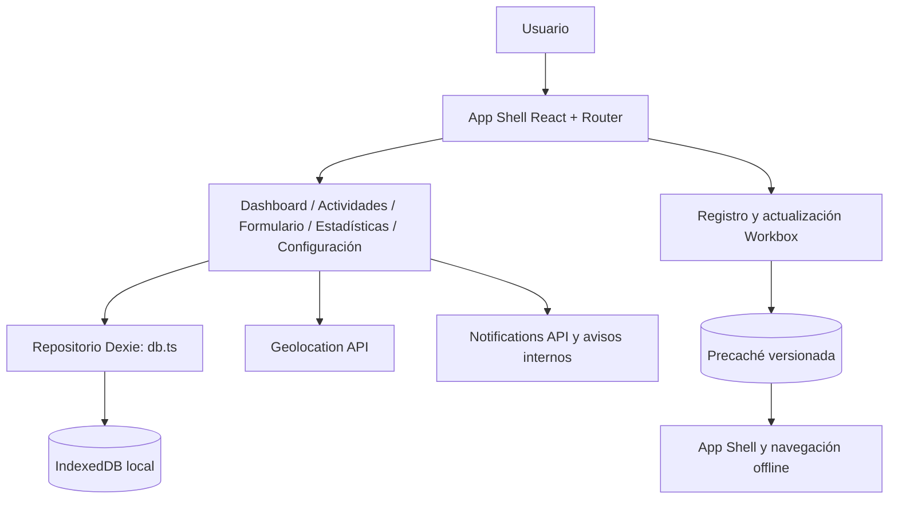
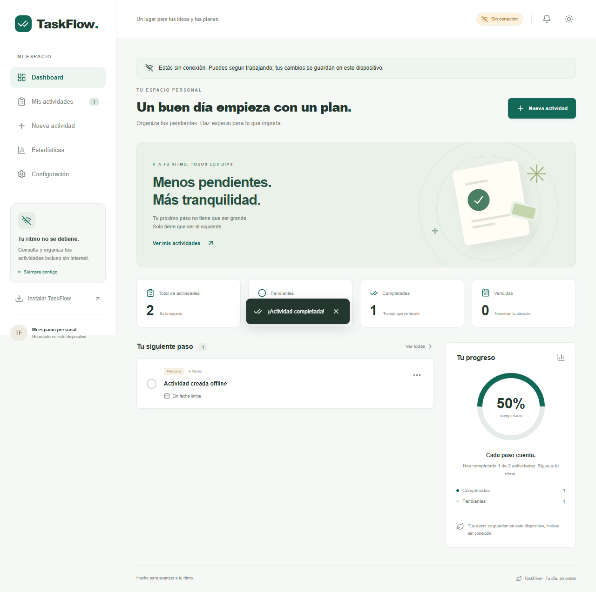
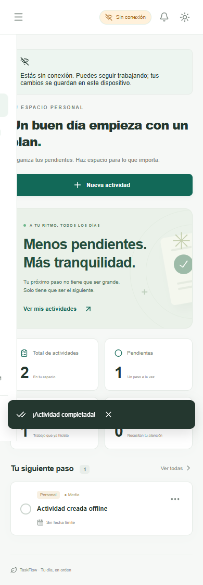
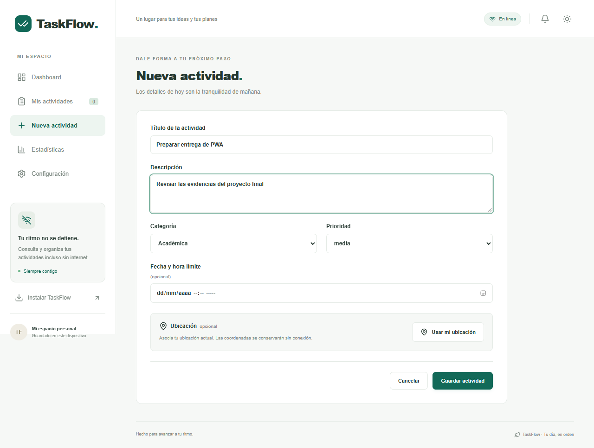
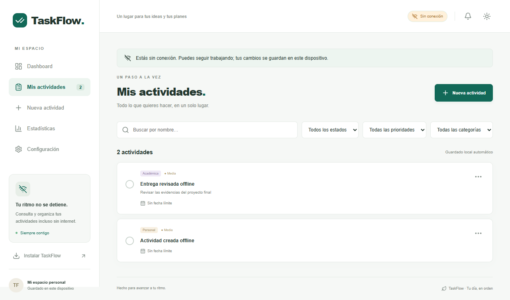
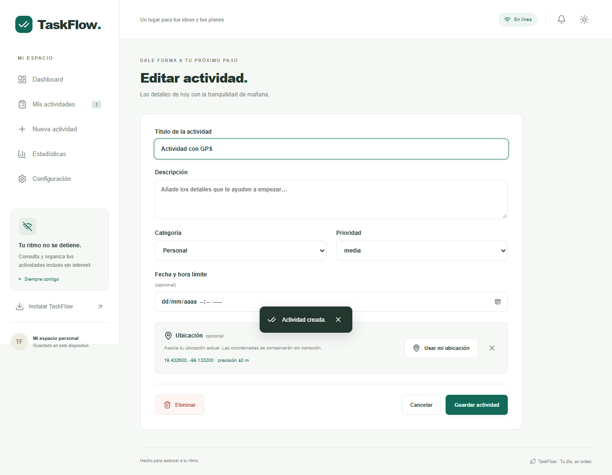
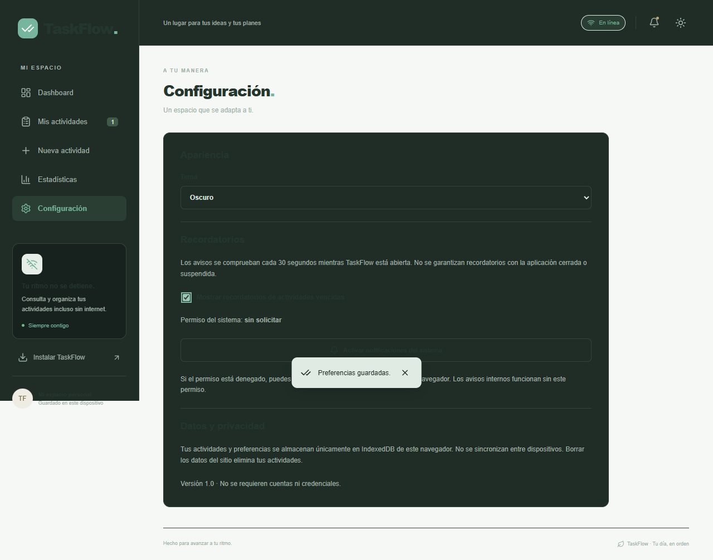

# TaskFlow — Gestor Inteligente de Actividades

Tu día, en orden. PWA en español para organizar actividades personales, académicas y laborales, con persistencia local y uso sin conexión.

**Repositorio:** https://github.com/TheFrisk777/PWA  
**Producción HTTPS:** pendiente de despliegue en una cuenta de Vercel o Netlify. No se ha asignado ni verificado una URL pública.

## Problema y objetivo

Una conexión intermitente no debería impedir organizar el trabajo. TaskFlow permite crear, consultar, editar, completar y eliminar actividades sin servidor. Los datos permanecen en el mismo navegador y dispositivo después de recargar.

## Funcionalidades

- Dashboard con próximos pendientes, conteos y progreso.
- CRUD de actividades, confirmación de eliminación y validación.
- Categorías Personal, Académica y Laboral; prioridades alta, media y baja.
- Búsqueda por título y filtros combinables de estado, prioridad y categoría.
- Fecha y hora límite, estado completado y estadísticas por categoría.
- Coordenadas opcionales obtenidas mediante una acción explícita, con manejo de errores.
- Recordatorios internos de vencimientos y notificaciones del sistema bajo permiso.
- Tema claro/oscuro persistente, menú móvil y estados vacíos/de error.
- Instalación asistida e indicador de conexión; actualización del Service Worker bajo acción del usuario.

No se requiere autenticación ni credenciales. La aplicación empieza vacía; los registros de las capturas son actividades creadas durante las pruebas, no datos precargados.

## Tecnologías y arquitectura

React y TypeScript para CSR; Vite para desarrollo/producción; React Router para vistas; Dexie para transacciones asíncronas de IndexedDB; Workbox mediante vite-plugin-pwa para precaché, ciclo de vida y actualización; Lucide para iconos. CSS responsivo sin recursos externos. Vitest/fake-indexeddb y Playwright para validación. No se usa LocalStorage como base de datos.



```text
src/
  App.tsx           App Shell, vistas y flujos de interacción
  db.ts             Modelo, esquema v1, validación y guardado
  db.test.ts        Pruebas del almacenamiento
  main.tsx          Punto de entrada CSR
  styles.css        Temas y diseño responsivo
public/icons/       PNG 192, 512, maskable y Apple 180
tests/              Pruebas funcionales con navegador
docs/evidencias/    Capturas reales y diagnóstico
docs/VALIDACION_RUBRICA.md
vite.config.ts      Manifest y estrategias Workbox
netlify.toml        Build, rutas SPA y cabeceras
vercel.json         Rutas SPA y cabeceras
```

## Instalación y ejecución

Requisitos: Node.js 22.12+ o 24+, npm y Git. Para las pruebas E2E, Microsoft Edge instalado (se usa `channel: msedge`).

```bash
git clone https://github.com/TheFrisk777/PWA.git
cd PWA
npm ci
npm run dev
```

El servidor muestra la dirección local. Desarrollo no registra el Service Worker: para probar la PWA se usa la compilación de producción.

```bash
npm run build
npm run preview -- --port 4173
```

Abre http://127.0.0.1:4173. Loopback se considera contexto seguro para desarrollo. Los dispositivos remotos requieren HTTPS; no abras `dist/index.html` mediante `file://`.

## Uso e instalación PWA

1. Pulsa Nueva actividad, completa título, categoría y prioridad; opcionalmente agrega descripción, fecha y ubicación. Pulsa Guardar actividad.
2. Usa el círculo para completar y el título o menú de puntos para editar. Elimina desde el formulario y confirma.
3. Busca y combina filtros en Mis actividades. Consulta los totales en Dashboard y Estadísticas.
4. Activa recordatorios y el tema en Configuración. El permiso de ubicación se solicita al pulsar Usar mi ubicación; las notificaciones se solicitan mediante su botón propio.
5. Espera a que termine la primera carga online. Puedes después consultar, crear, editar, completar y eliminar offline.
6. Usa Instalar TaskFlow. Si el navegador emite `beforeinstallprompt`, se abre el diálogo nativo. En Safari móvil: Compartir → Añadir a pantalla de inicio. En Chrome/Edge también puedes usar el menú Instalar aplicación. La disponibilidad depende del navegador y de si ya está instalada.

## Manifest y Service Worker

Vite genera `dist/manifest.json`, enlazado desde HTML, con nombre, descripción, idioma, `id`, `start_url`, `scope`, colores y `display: standalone`. Incluye PNG reales de 192×192 y 512×512, icono maskable de 512×512 con símbolo dentro de la zona segura y Apple Touch de 180×180.

Workbox genera `sw.js` y su runtime. Durante instalación precachea HTML, JS, CSS e iconos con revisión de contenido; durante activación elimina entradas antiguas. Intercepta GET del mismo origen y sirve el App Shell para rutas SPA offline. Una versión nueva permanece esperando hasta que el usuario pulsa Actualizar ahora. No se fuerza una recarga en bucle. El nuevo controlador gestiona el relevo mediante workbox-window.

| Recurso                           | Estrategia                          | Motivo                                                            |
| --------------------------------- | ----------------------------------- | ----------------------------------------------------------------- |
| App Shell y bundles con revisión  | Precache / Cache First              | Disponibilidad offline y revisión por build                       |
| Iconos                            | Precache; Cache First como respaldo | Recursos estables, límite de 10 entradas en caché runtime         |
| Manifest                          | Stale While Revalidate              | Copia pública reutilizable y revisión online                      |
| Datos de usuario                  | IndexedDB, fuera de Cache API       | CRUD local sin servidor                                           |
| Servicios dinámicos externos      | No aplicable                        | No existen llamadas a estos servicios; no se simula Network First |
| Otras peticiones / métodos no GET | Red normal, sin regla de caché      | No se almacenan operaciones sensibles; equivalente a Network Only |

No se cachean autenticación ni APIs privadas. No se necesita Network First para un servicio inexistente. Las cachés pertenecen al origen; para otro proyecto utiliza otro origen.

## IndexedDB y privacidad

Base `taskflow`, esquema Dexie versión 1 (IndexedDB expone versión 10 por la convención interna de Dexie). Tablas:

| Tabla    | Clave y contenido                                                                                                                                            |
| -------- | ------------------------------------------------------------------------------------------------------------------------------------------------------------ |
| tasks    | `id` UUID; título, descripción, categoría, prioridad, completado, creación, modificación, vencimiento y ubicación opcional `{latitude, longitude, accuracy}` |
| settings | Clave `preferences`; tema y preferencia de recordatorios                                                                                                     |

Índices en título, categoría, prioridad, estado y vencimiento. Todas las operaciones usan promesas; el formulario espera confirmación de escritura y muestra errores. No hay migraciones históricas porque es la primera versión: futuras versiones deben usar `version(2).stores(...).upgrade(...)` conservando datos. El booleano de estado se filtra en memoria, no mediante el índice (IndexedDB no indexa booleanos).

Los datos no salen del dispositivo ni se sincronizan. El navegador puede eliminar almacenamiento bajo presión o al borrar datos del sitio. No hay copia de seguridad ni garantía contra borrado del perfil. Si IndexedDB no está disponible, se muestra un bloqueo explícito en lugar de simular guardado.

## Web APIs y limitaciones

**Geolocation:** `getCurrentPosition` solo tras una acción explícita; timeout 12 segundos, caché máxima de 60 segundos. Se guardan coordenadas y precisión, consultables offline. Se distinguen permiso denegado, posición no disponible y timeout. El GPS real puede no funcionar sin red o sin sensores. No hay geocodificación ni mapa externo.

**Notifications:** detección de soporte y `Notification.requestPermission()` desde un clic. Se usa `ServiceWorkerRegistration.showNotification` bajo permiso concedido. Sin permiso o soporte, continúan los avisos internos. El estado de permiso se muestra en Configuración. El permiso denegado se cambia desde ajustes del navegador.

Los vencimientos se comprueban cada 30 segundos mientras la app está abierta; se notifican una vez por actividad y fecha en la sesión. Pueden repetirse al abrir una nueva sesión. No son Web Push: no hay servidor de push ni garantía de avisos con la app cerrada o suspendida. iOS puede exigir instalación para ciertas capacidades. La Permissions API no es necesaria para estas operaciones y no se presupone compatibilidad universal.

## Publicar en HTTPS

No se necesita ninguna variable de entorno ni secreto. No hay cuenta Vercel/Netlify conectada en esta sesión, por lo que la publicación y verificación pública están pendientes.

**Vercel:** entra en tu cuenta → Add New → Project → importa `TheFrisk777/PWA` → selecciona rama `main` y preset Vite → build `npm run build`, salida `dist` → Deploy. La configuración SPA está en `vercel.json`.

**Netlify:** entra en tu cuenta → Add new project → Import an existing project → GitHub → `TheFrisk777/PWA` → rama `main`. `netlify.toml` establece build `npm run build`, directorio `dist`, rutas SPA y `Cache-Control: no-cache` para `sw.js`. Publica y espera la URL HTTPS real.

Después de publicar: abre la URL, visita `/actividades` directamente, verifica recursos y consola, inspecciona Application → Manifest / Service Workers, instala y abre en standalone, recarga offline. Reemplaza el estado pendiente de este README con la URL real y guarda capturas de producción en `docs/evidencias/`.

## Pruebas y evidencias

```bash
npm test
npm run build
npm run test:e2e
npm audit --omit=dev
```

Playwright prueba la compilación, inicia su propio servidor en 4173 y usa contextos aislados. Su modo offline bloquea la red del contexto, sin desconectar físicamente el equipo. El GPS concedido usa coordenadas controladas y el caso denegado usa un error inyectado: no son mediciones de un sensor físico.

Consulta [la matriz de evaluación](docs/VALIDACION_RUBRICA.md) y [el registro de pruebas](docs/PRUEBAS.md) para resultados, limitaciones y verificaciones manuales. Las capturas se obtienen de ejecuciones reales automatizadas. El diagnóstico JSON contiene estado del Service Worker, caches y base detectada; **no sustituye capturas de DevTools ni demuestra instalación standalone**.








Pendientes de evidencia manual: paneles DevTools IndexedDB, Service Worker y Manifest; instalación de escritorio y móvil, modo standalone, diálogo real de permisos, sensor físico y URL pública. No se ejecutó Lighthouse. La calificación corresponde al docente, no se declara 30/30.

## Entrega

Entrega el enlace del repositorio y, cuando esté publicada, la URL HTTPS. Adjunta `docs/VALIDACION_RUBRICA.md`, `docs/PRUEBAS.md` y `docs/evidencias/`. La entrega en la plataforma educativa corresponde al estudiante; no hay una fecha o nomenclatura impuesta por este proyecto.
